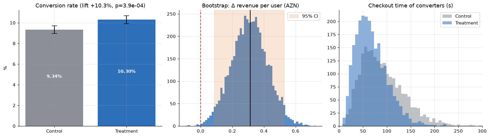
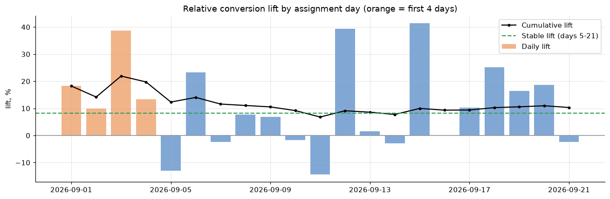
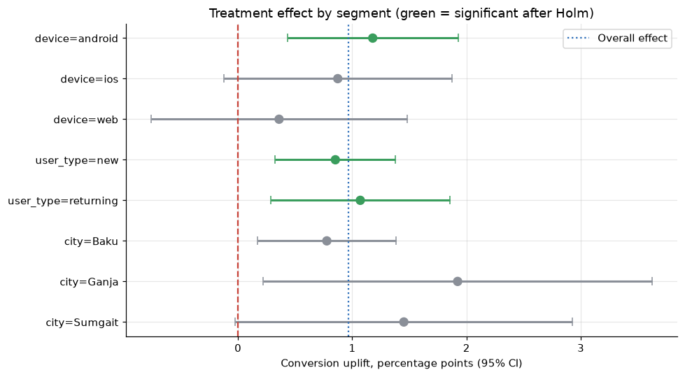

# 🧪 A/B Test — One-Page Checkout Redesign

> **Daily Data Analytics Project · Day 04**

A full experiment readout for a Baku food-delivery app: did a new **one-page checkout** really increase orders and revenue? Should we ship it, and to whom?

## 🎯 Business question
The app replaced its 3-step checkout (cart → address → payment) with a single page. For **21 days (1–21 Sep 2026)** ~48K new visitors were randomised 50/50 into **control** (old flow) and **treatment** (new flow).

1. Did conversion and **revenue per user** go up — by how much and how certain are we?
2. Did any **guardrail** (cancellations, basket size) get worse?
3. Does the effect hold for every segment (Android / iOS / web, new / returning, city)?
4. Is the test **trustworthy** (sample-ratio mismatch, contamination, novelty, power)?

## 📊 Key results

| KPI | Control | Treatment | Lift |
|---|---|---|---|
| Users (after cleaning) | 24,015 | 23,845 | SRM p = 0.44 ✅ |
| Conversion rate | 9.34% | **10.30%** | **+10.3%** (+0.96 pp, 95% CI [+0.43, +1.50] pp, p = 0.0004) |
| Revenue per user | 3.16 AZN | **3.47 AZN** | **+9.9%** (bootstrap 95% CI [+0.09, +0.53] AZN, p = 0.006) |
| Avg order revenue | 33.84 AZN | 33.72 AZN | −0.4% (p = 0.85) — no harm |
| Cancellation rate | 4.95% | 5.01% | +0.06 pp (p = 0.93) |
| Median checkout time | 84 s | **63 s** | **−24%** |

| Test health & impact | Value |
|---|---|
| Data issues removed | 560 rows (220 duplicate exposures, 140 users in both groups, 60 QA accounts) + 35 missing revenues imputed |
| Novelty effect | Lift **+19.8%** in days 1–4 → **+8.2%** in days 5–21 |
| CUPED variance reduction | **−11%** (conversion), −8% (revenue) using pre-period orders |
| MDE at 80% power | 0.75 pp (≈ 8% relative); achieved power 95% |
| Extra revenue / year | **≈ 208K AZN** (novelty-adjusted; 261K point estimate, 72K at CI low) |





## 🔍 Segments (Holm-adjusted)
| Segment | Rel. lift | Holm p | Significant |
|---|---|---|---|
| Android | +12.4% | 0.014 | ✅ |
| iOS | +8.3% | 0.17 | — (directionally positive) |
| Web | +5.2% | 0.53 | — |
| New users | **+28.8%** | 0.012 | ✅ |
| Returning users | +8.1% | 0.044 | ✅ |

## 💡 Recommendations
1. **Ship the one-page checkout in the mobile apps** — Android is a clear win, iOS is directionally positive with no guardrail harm.
2. **Hold web** — no detectable lift; iterate (address autocomplete, guest checkout) and re-test.
3. **Plan on the stable lift (+8%), not the launch spike** — the first 4 days were inflated by novelty.
4. **Monitor cancellations after launch** — no increase seen, but the test was too small to prove non-inferiority at a 1 pp margin; set a rollback trigger.
5. **Use CUPED by default** — 11% lower variance means shorter experiments for the same power.
6. **Automate pre-checks** — SRM test, duplicate-exposure and QA-account filters before every readout.

## 🛠 Tech stack
Python · pandas · NumPy · SciPy (two-proportion z-test, Welch t-test, χ² SRM, Mann-Whitney) · bootstrap · CUPED · Holm–Bonferroni · power analysis · matplotlib · Jupyter

## 📁 Structure
```
├── ab_test_analysis.ipynb   # full readout (data checks → tests → segments → decision)
├── build_notebook.py        # builds the notebook with nbformat
├── data/
│   ├── generate_data.py     # reproducible synthetic dataset generator
│   └── checkout_ab_test.csv # 48,420 exposure rows, 13 columns
├── images/                  # exported charts
└── requirements.txt
```

## ▶️ Run it
```bash
pip install -r requirements.txt
python data/generate_data.py   # optional: regenerate the dataset
python build_notebook.py       # optional: rebuild the notebook
jupyter notebook ab_test_analysis.ipynb
```

> ℹ️ The dataset is **synthetic** (generated with a fixed seed), modelled on typical e-commerce experiment patterns, including deliberate data-quality problems. No real company or customer data is used.

---

### 🇦🇿 Azərbaycanca xülasə
Bakıdakı yemək çatdırılması tətbiqində yeni **bir səhifəlik checkout**-un A/B testi. 21 gün ərzində ~48 min istifadəçi iki qrupa bölündü. Yeni axın konversiyanı **9.34%-dən 10.30%-ə (+10.3%)**, istifadəçi başına gəliri **+9.9%** artırdı, checkout vaxtını isə **84 → 63 saniyəyə** endirdi; ləğv nisbəti və səbət dəyəri dəyişmədi. Effekt **Android** və **yeni istifadəçilərdə** ən güclüdür, vebdə isə statistik əhəmiyyətli deyil. İlk 4 gündə "yenilik effekti" var (+19.8% → sabit +8.2%). Tövsiyə: mobil tətbiqlərdə tətbiq etmək, vebi təkmilləşdirib yenidən test etmək; illik gözlənilən əlavə gəlir ≈ **208 min AZN**.
